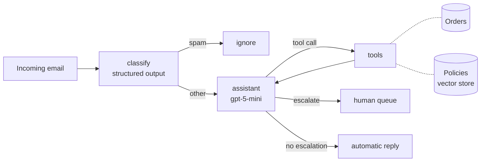

# AI Customer Support Agent (LangGraph + RAG + Evals)

An AI agent that triages customer support emails for **TechCasa**, a fictional Portuguese online electronics store. It classifies each email, decides when a human needs to step in, looks up real order data and store policies, and drafts a grounded reply. Built in Python with LangGraph, with an automated evaluation suite.

## What it does

- **Classifies** emails into six categories (orders, returns, technical, information, complaints, spam) and **extracts** customer name, order number, urgency and a summary as structured output (Pydantic).
- **Filters spam first**, so spam never reaches the agent and costs no tool calls.
- **Escalates to a human** based on explicit business rules: legal or public complaint threats, refunds above €200, or repeated unanswered contacts.
- **Uses two tools:** an order lookup (status, delivery date, carrier) and a RAG search over the store policies (warranty, returns, shipping, payments, troubleshooting).
- **Writes the reply knowing the routing decision**, so it never promises follow-up on emails that won't get one.

## Architecture



Routing decisions are plain Python functions on the graph's conditional edges, not model decisions: the model classifies, the code decides where the email goes.

## Evaluation

`evals.py` runs the agent on 12 test emails, including edge cases such as refunds above the escalation limit, orders that don't exist, cancelled orders and angry customers that don't meet any escalation rule.

| Metric | Type | Result |
|---|---|---|
| Category | Exact match | 12/12 |
| Escalation decision | Exact match | 12/12 |
| Order tool used when expected | Agent trajectory | 10/12 |
| Policy tool used when expected | Agent trajectory | 6/7 |
| Reply quality | LLM-as-judge | 11/11 |

The **LLM-as-judge** checks each reply for invented information, promises of actions the agent can't perform, and contradictions with the routing decision. Its rubric was validated by manually reviewing the replies.

The two order-tool misses are cases where the agent looked up the order before answering a return or refund request. This is reasonable behaviour, so the test expectation is likely too strict rather than the agent being wrong.

## Tech stack

Python · LangGraph · LangChain · OpenAI `gpt-5-mini` and `text-embedding-3-small` · Pydantic structured output · in-memory vector store (RAG)

## How to run

```bash
python -m venv .venv
source .venv/bin/activate
pip install -r requirements.txt
echo "OPENAI_API_KEY=your-key" > .env
python agente.py   # run 4 example emails
python evals.py    # run the full evaluation
```

All data in this project is fictional. A low-code version of the same agent was also built in n8n.

---

Built by João as part of my AI Engineering portfolio.
